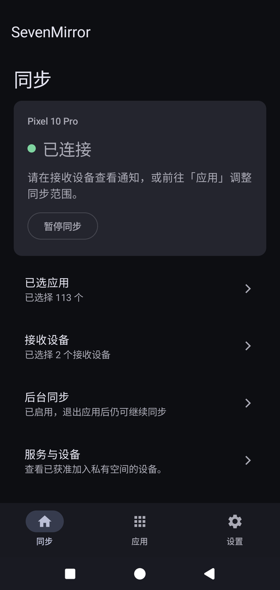
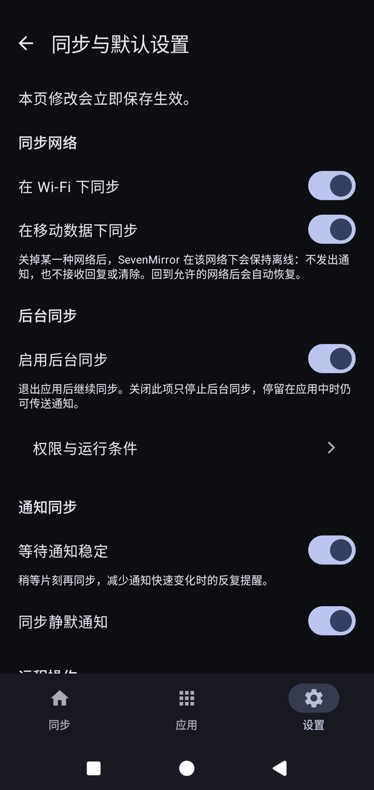

<div align="center">
  

  # SevenMirror Android

[Project hub](https://github.com/huaxianyan/SevenMirror-Project) · [Server](https://github.com/huaxianyan/SevenMirror-Server) · [Chrome extension](https://github.com/huaxianyan/SevenMirror-Extension) · Android app

English | [简体中文](README.md)
</div>

Sends the notifications on your phone to your own browsers. The app captures notifications on the phone, encrypts each one per receiving browser, and the relay server forwards the ciphertext; once content leaves the phone, the relay cannot read it.

SevenMirror is a self-hosted, multi-repository project; this repository is its Android client.

## Screenshots

<p align="center">
  
  
</p>

## Features

- **Notification mirroring**: sends only the apps you selected, encrypted per receiving browser before it leaves the phone.
- **Act on notifications from the computer**: mark as done, reply and clear all start in the browser; the phone re-checks the notification revision before acting.
- **You choose where they go**: pick the receiving browsers under Settings → Receiving devices; unselected browsers receive nothing.
- **Per-network switches**: Wi-Fi and mobile data can be turned off separately; on a disallowed network the connection does not exist at all, and it comes back by itself on an allowed one.
- **Pause and resume**: one switch pauses sending, remote actions and snapshot answers without dropping the background connection, and it survives a restart.
- **Per-application control**: each app decides on its own whether to mirror, whether to sync the body, and whether remote actions are allowed.
- **Background and restart**: the connection recovers after leaving the app, locking the screen or rebooting, with no need to open the app again.
- **Reconnects on its own**: network flapping leads to a backoff and reconnect, not to a page demanding re-registration.

## Quick start

Prerequisites: a running SevenMirror relay; see the [server repository](https://github.com/huaxianyan/SevenMirror-Server) for how to host one.

1. Install the app, as described in "Download" and "Building from source" below.
2. Open the app and complete the first-run flow, which asks whether to enable background sync.
3. Enter the one-time join code issued by the operator to join the private space.
4. Choose the apps to mirror, then tick the browsers that should receive notifications under Settings → Receiving devices. Install the extension in the browser from the [Chrome Web Store](https://chromewebstore.google.com/detail/fibpoeijlejjkokmngpcoahdhbjigcma).

The device display name is set by the operator in the admin interface and is read-only in the app.

### Download

Release builds come from [GitHub Releases](https://github.com/huaxianyan/SevenMirror-Android/releases), with file names like `sevenmirror-android-0.1.0.apk`.

<a href="https://apps.obtainium.imranr.dev/redirect?r=obtainium://app/%7B%22id%22%3A%22com.neko7ina.sevenmirror%22%2C%22url%22%3A%22https%3A%2F%2Fgithub.com%2Fhuaxianyan%2FSevenMirror-Android%22%2C%22author%22%3A%22huaxianyan%22%2C%22name%22%3A%22SevenMirror%22%7D"></a>

With [Obtainium](https://github.com/ImranR98/Obtainium) installed, the button above adds this project to your update list and new versions are checked automatically.

```text
Application ID: com.neko7ina.sevenmirror
min SDK:        29 (Android 10)
target SDK:     35 (Android 15)
```

### Building from source

JDK 17 and the Android SDK are required (`compileSdk` 37, `targetSdk` 35, `minSdk` 29). Use the Gradle wrapper that ships with the repository:

```sh
./gradlew verifyKotlinKaptAdvisoryGuard verifyVendoredProtocol test lint assembleDebug
```

On Windows, use `gradlew.bat` in PowerShell or the command prompt. The artefact ends up at `app/build/outputs/apk/debug/app-debug.apk`.

## Usage and configuration

The home screen is arranged in four blocks: selected apps, receiving devices, background sync, and service and device. Connection state uses a three-colour dot: green for connected, amber for in progress or paused, red for disconnected. When disconnected the only manual action is "Reconnect", because pausing while nothing is being transmitted changes nothing.

Settings are grouped in four:

- **Sync and default settings**: sync network (Wi-Fi and mobile data separately), background sync, notification stability wait, and defaults for silent notifications and remote actions.
- **Receiving devices**: which browsers this phone sends to; an empty selection is valid.
- **Permissions and runtime conditions**: a permanent page showing the actual state, purpose and impact of notification access, notification permission and battery optimisation exemption, re-checked when you come back from system settings.
- **Test notification**: creates a real notification and walks it through the normal delivery path, to confirm the browser side receives it.

Whether an individual app is mirrored, whether its body is synced, and whether remote actions are allowed are set on the per-app policy page reached from the Apps list. Ongoing notifications are not mirrored by default; turn them on per app when needed.

## Documentation

- [Product interface](docs/product-interface.md): screen structure, business boundaries and known todos.
- [Background connection](docs/background-connection.md): foreground service, heartbeat and reconnect policy.
- [Notification stability wait](docs/notification-stability.md): how the wait window is computed, and the switch behaviour.
- [Transport timeline](docs/transport-diagnostics.md): diagnostic event fields and troubleshooting steps.
- [Signing](docs/SIGNING.md): signing identity, backup and restore.
- [Release provenance](docs/release-provenance.md): release artefacts, offline verification and rollback.
- [Release actions](docs/release-actions.md): actions and permissions used by the release workflow.
- [Vulnerability evidence](docs/vulnerability-evidence.md): dependency inventory and vulnerability scan evidence.
- [Sensitive data](docs/SENSITIVE_DATA.md): local sensitive-data inventory.
- [KAPT analysis](docs/kotlin-kapt-advisory-analysis.md): Kotlin plugin advisories and the no-KAPT boundary.
- [Protocol assets](protocol/README.md): versions and verification of the protocol schema.

Cross-component progress and handover records live in `docs/STATUS.md` of the [project hub](https://github.com/huaxianyan/SevenMirror-Project).

## License

This revision is licensed under [`GPL-3.0-only`](LICENSE). Commercial use is allowed, and distribution must follow GPLv3. Previously released MIT versions are unaffected retroactively; the exact MIT-to-GPL boundary is in [`LICENSE-TRANSITION.md`](LICENSE-TRANSITION.md), and that boundary revision and its ancestors remain available under MIT.
