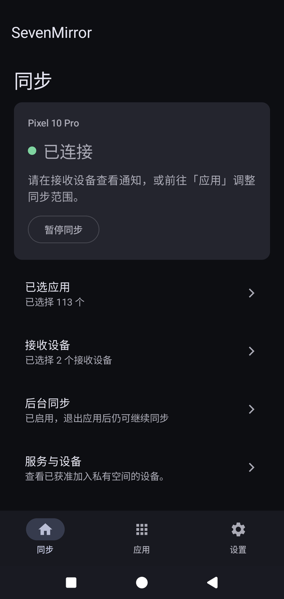
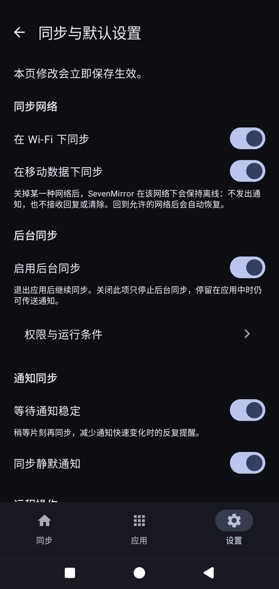

<div align="center">
  

  # SevenMirror Android
</div>

把手机上的通知送到你自己的浏览器。本应用是发送端，在手机上捕获通知、按收件浏览器分别加密，再由中继服务器转发密文。正文离开手机后，中继读不到。

SevenMirror 是自托管的三仓库项目：本仓库是 Android 发送端，另有 [服务端](https://github.com/huaxianyan/SevenMirror-Server)与 [浏览器扩展](https://github.com/huaxianyan/SevenMirror-Extension)。

## 截图

<p align="center">
  
  
</p>

## 特性

- **通知镜像**：只发送你在手机上选中的应用，离机前按收件浏览器分别加密。
- **在电脑上处理通知**：标记完成、回复、清除都能从浏览器发起，手机执行前重新核对通知版本。
- **自己决定发给谁**：在「设置 → 接收设备」里选择接收的浏览器，未选中的浏览器收不到内容。
- **按网络开关同步**：Wi-Fi 与移动数据可以分别关闭，关掉的网络下整条连接不存在，换到允许的网络自动恢复。
- **暂停与恢复**：一键暂停发送、远程操作与快照响应，不释放后台连接，重启后保留。
- **逐应用控制**：每个应用单独决定是否镜像、是否同步正文、是否允许远程操作。
- **后台与重启**：退出应用、锁屏与重启之后连接自行恢复，不需要手动打开应用。
- **掉线自己重连**：网络抖动导致的断开会退避重连，不会跳到要求重新注册的页面。

## 快速开始

前提是一台已经跑起来的 SevenMirror 中继服务，搭建方式见 [服务端仓库](https://github.com/huaxianyan/SevenMirror-Server)。

1. 安装应用：从 [Releases](https://github.com/huaxianyan/SevenMirror-Android/releases) 下载 `sevenmirror-android-<版本>.apk`，或者自行构建。
2. 打开应用走完首次引导，其中会问是否开启后台同步。
3. 输入运维者签发的一次性加入码，加入私有空间。
4. 选择要镜像的应用，再到「设置 → 接收设备」勾选接收通知的浏览器。

设备显示名由运维者在管理端设定，应用里只读展示。

### 自行构建

需要 JDK 17 与 Android SDK（`compileSdk` 37、`targetSdk` 35、`minSdk` 29），构建用仓库自带的 Gradle wrapper：

```sh
./gradlew verifyKotlinKaptAdvisoryGuard verifyVendoredProtocol test lint assembleDebug
```

Windows 的 PowerShell 或命令提示符下改用 `gradlew.bat`。产物在 `app/build/outputs/apk/debug/app-debug.apk`。

## 使用与配置

首页按四块排列：已选应用、接收设备、后台同步、服务与设备。连接状态用三色点表示，绿为已连接、黄为进行中或已暂停、红为未连接。未连接时唯一的手动动作是「重新连接」，因为没在传输时暂停不改变任何事。

设置分四组：

- **同步与默认设置**：同步网络（Wi-Fi 与移动数据分别开关）、后台同步、通知稳定等待、静默通知与远程操作的默认值。
- **接收设备**：本手机向哪些浏览器发送，空选择合法。
- **权限与运行条件**：常驻页面，显示通知使用权、通知权限与电池优化豁免的实际状态、用途和缺失影响，从系统设置返回后重新核对。
- **测试通知**：生成一条真实通知，按正常发送路径走一遍，用来确认浏览器端能否收到。

单个应用是否镜像、是否同步正文、是否允许远程操作，在「应用」列表进入的策略页里设置。持续通知默认不镜像，需要时按应用打开。

## 文档

| 主题 | 文档 |
| --- | --- |
| 界面结构、业务边界与已知待办 | [产品界面](docs/product-interface.md) |
| 后台连接、前台服务与重连策略 | [后台连接](docs/background-connection.md) |
| 通知稳定等待的窗口与开关 | [通知稳定等待](docs/notification-stability.md) |
| 传输诊断与故障排查 | [传输时间线](docs/transport-diagnostics.md) |
| 签名身份、备份与恢复 | [签名](docs/SIGNING.md) |
| 发布产物、离线校验与回滚 | [发布溯源](docs/release-provenance.md) |
| 发布流程用到的 Action 与权限 | [发布 Action](docs/release-actions.md) |
| 依赖清单与漏洞证据 | [漏洞证据](docs/vulnerability-evidence.md) |
| 本地敏感数据清单 | [敏感数据](docs/SENSITIVE_DATA.md) |
| Kotlin 插件告警与无 KAPT 边界 | [KAPT 分析](docs/kotlin-kapt-advisory-analysis.md) |
| 协议资产、版本与校验方式 | [协议资产](protocol/README.md) |

跨组件的进度与交接记录在 [项目总仓库](https://github.com/huaxianyan/SevenMirror-Project)的 `docs/STATUS.md`。

## 许可证

当前修订版使用 [`GPL-3.0-only`](LICENSE)。允许商业使用，但分发时必须遵守 GPLv3。此前已经发布的 MIT 版本不受追溯影响，精确的 MIT 到 GPL 边界见 [`LICENSE-TRANSITION.md`](LICENSE-TRANSITION.md)，该边界修订及其祖先仍按 MIT 提供。
